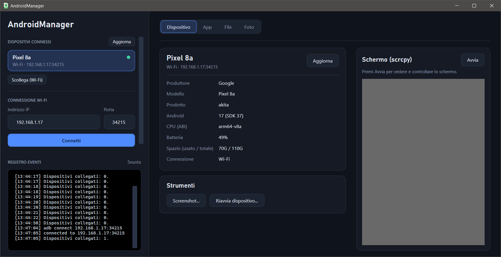
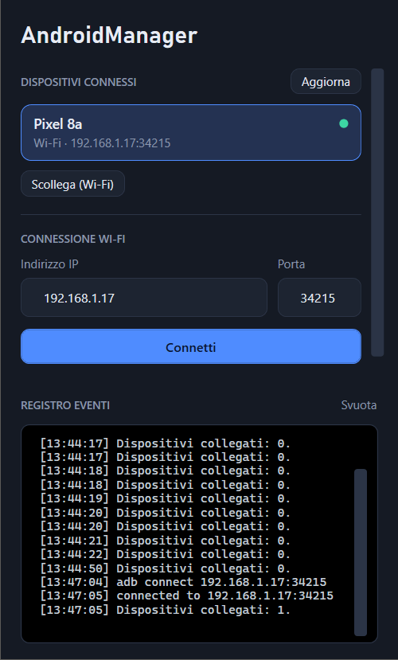
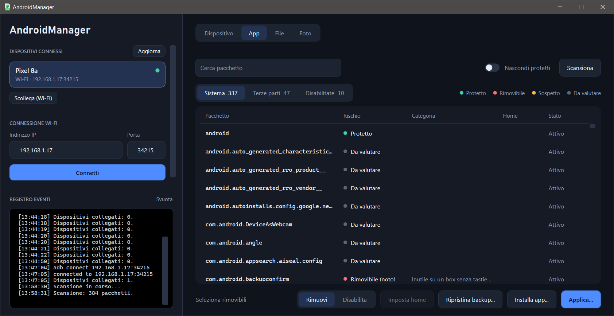
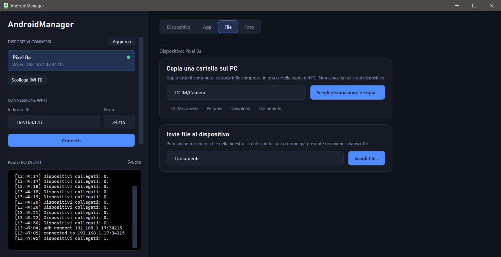
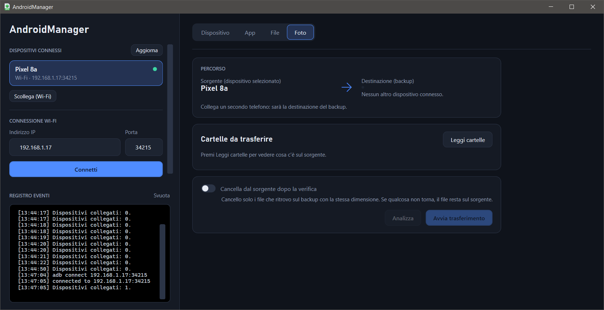

# Android Manager

🇮🇹 Italiano · [🇬🇧 English](README.md)

**Un'app desktop per Windows che gestisce telefoni, TV box e tablet Android via USB o Wi-Fi: elimina il bloatware, installa APK, sposta file, salva le foto e mostra lo schermo, tutto da una finestra.**

I TV box Android economici arrivano con decine di app preinstallate che nessuno ha chiesto, e spostare file o foto tra dispositivi
di solito vuol dire cavi, account cloud o una serie di comandi `adb` da terminale. AndroidManager mette `adb` dietro una finestra semplice.
Non cambia nulla senza chiedere, salva un backup di ciò che rimuove e controlla la copia delle foto prima di cancellare l'originale.
È scritto in C# con WPF su .NET 10.



## Funzioni principali

- **Più dispositivi insieme**: i dispositivi USB e Wi-Fi stanno in un'unica lista a sinistra. Scegli quello su cui lavorare.
- **Connessione e abbinamento Wi-Fi**: connessione con IP e porta, oppure abbinamento con il codice di Android 11+, senza cavo.
- **Dati del dispositivo**: produttore, modello, versione di Android, CPU, batteria, spazio e tipo di connessione.
- **Schermo in diretta con scrcpy**: vedi e controlli lo schermo dal PC. scrcpy è dentro l'exe, non devi installare nulla.
- **Pulizia del bloatware**: elenca ogni pacchetto, lo classifica per rischio e rimuove o disabilita quelli che scegli.
- **Backup e ripristino**: ogni rimozione finisce in un backup che puoi ripristinare, anche per le app solo disabilitate.
- **Scelta della home**: decidi quale app installata fa da schermata home.
- **Installazione APK**: scegli gli APK o trascinali nella finestra. Ogni file viene controllato prima dell'invio.
- **Trasferimento file**: invia file al dispositivo, oppure copia un'intera cartella sul PC.
- **Backup foto tra due telefoni**: copia le cartelle scelte, verifica la copia e cancella dal sorgente solo ciò che il backup contiene.
- **Sicuro per costruzione**: i pacchetti di sistema protetti sono bloccati, i passaggi a rischio chiedono conferma e chiudendo la finestra si ferma il server `adb` avviato dall'app.

## Prima di iniziare

Serve un PC Windows e un dispositivo con il **debug USB** attivo (Impostazioni → Info sul telefono → tocca sette volte *Numero build* → Opzioni sviluppatore → Debug USB).
Per il Wi-Fi su Android 11 o successivo usa **Debug wireless** nello stesso menu.

- **adb**: l'app cerca `adb.exe` in una cartella `adb` accanto all'exe, poi nel `PATH`. `adb` non è incluso: installa le
  [platform-tools di Android](https://developer.android.com/tools/releases/platform-tools) e aggiungile al `PATH`.
- **scrcpy**: è già dentro l'exe e si estrae da solo al primo uso. Se preferisci una copia tua, usa **Scegli scrcpy.exe...**.
- **Runtime**: l'exe pronto in [`Extra/Build`](Extra/Build) richiede il .NET 10 Desktop Runtime. Se Windows lo chiede, installalo.

## La finestra principale

Dispositivi, connessione e registro a sinistra. Quattro schede a destra: **Dispositivo**, **App**, **File** e **Foto**.



### Trovare e collegare i dispositivi

- **Scansiona** elenca ogni dispositivo che `adb` vede, USB e Wi-Fi. Parte da sola all'avvio dell'app.
- Un pallino verde indica un dispositivo pronto. Un pallino ambra indica offline o **non autorizzato**: accetta il popup di debug sul telefono e scansiona di nuovo.
- **Connetti**: scrivi IP e porta (5555 di default). Gli ultimi valori vengono ricordati.
- **Abbina**, Android 11+: sul telefono apri *Debug wireless → Abbina dispositivo con codice*. Scrivi l'IP, la **Porta di abbinamento** e il **Codice**, premi **Abbina**, poi **Connetti** con la porta di debug.
- **Scollega (Wi-Fi)** compare quando è selezionato un dispositivo Wi-Fi.
- Il **Registro eventi** in basso elenca ogni passaggio con l'ora. **Svuota** lo pulisce. Una barra di avanzamento sopra mostra l'operazione in corso.

Durante un'operazione pulsanti e schede sono bloccati. Se chiudi la finestra mentre è in corso, l'app chiede prima conferma.

## Scheda Dispositivo


- **Dati**: produttore, modello, prodotto, versione Android e SDK, ABI, batteria, spazio usato e totale, USB o Wi-Fi. **Aggiorna** li rilegge.
- **Screenshot...** salva sul PC un PNG dello schermo del dispositivo.
- **Riavvia dispositivo...** riavvia il dispositivo dopo una conferma.
- **Schermo (scrcpy)**: **Avvia** mostra lo schermo in diretta dentro la finestra e lo controlli con mouse e tastiera.
  Se scegli un altro dispositivo, lo specchio si ferma e parte quello nuovo. Chiudendo la finestra il processo scrcpy termina.

## Scheda App

Il gestore dei pacchetti. Premi **Scansiona** per leggere i pacchetti del dispositivo selezionato.



| Colonna | Significato |
|---|---|
| **Pacchetto** | Nome del pacchetto |
| **Categoria** | Perché è in elenco (per esempio *Google / servizi*, *App preinstallate*, *Strumenti di fabbrica / test*, *Launcher originali*) |
| **Rischio** | Livello di rischio, vedi sotto |
| **Stato** | Attiva o disabilitata |
| **Home** | L'app può fare da launcher |

**Filtri**: **Sistema**, **Terze parti** e **Disabilitate** (di sistema e terze parti), così da riabilitarle da qui.

**Livelli di rischio** (un suggerimento, mai un ordine: ogni dispositivo ha pacchetti diversi):

| Livello | Significato |
|---|---|
| **Protetto** | Non si tocca: nucleo di Android, impostazioni, installer, Kodi e gli strumenti dei launcher. Serve un consenso esplicito |
| **Rimovibile** | Bloatware già rimosso senza problemi su altri dispositivi |
| **Sospetto** | Il nome ricorda streaming, launcher o strumenti di fabbrica |
| **Da valutare** | Sconosciuto, decidi a mano |

### Rimuovere, disabilitare, ripristinare

1. Seleziona i pacchetti. **Seleziona rimovibili** sceglie tutti quelli *Rimovibile*. **Nascondi protetti** nasconde quelli protetti.
2. **Rimuovi** esegue `pm uninstall -k --user 0`: l'app sparisce per l'utente, l'APK resta su `/system`.
   **Disabilita** nasconde l'app senza rimuoverla.
3. L'app chiede prima una conferma, con il numero di pacchetti. I pacchetti protetti vengono saltati se non dai il consenso, e l'app rifiuta di rimuovere
   tutti i launcher, così il TV non resta mai senza schermata home.
4. Prima di toccare qualsiasi cosa l'app salva un **backup JSON** in `%AppData%\AndroidManager\backups`.
5. **Ripristina backup...** riporta i pacchetti di un backup. Un backup fatto su un altro dispositivo chiede conferma. **Riabilita...** riattiva le app disabilitate.

### Launcher della home

Seleziona un'app con un valore nella colonna **Home** e premi **Imposta home**. Il dispositivo la usa come launcher.
La colonna riporta **Attiva** per la home in uso e **Disponibile** per le altre.

### Installare APK

**Installa app...** apre la scelta del file, oppure trascina uno o più `.apk` nella finestra. L'app legge il manifest, valida ogni file
e chiede conferma con un resoconto di ciò che ha trovato. Un file non valido viene rifiutato e una versione più vecchia di quella installata chiede una seconda conferma.
L'avanzamento viene registrato ogni 25%.


## Scheda File



- **Invia file al dispositivo**: **Scegli file...** oppure trascina i file nella finestra. Un file con lo stesso nome già presente sul dispositivo non viene sovrascritto.
- **Copia una cartella sul PC**: scrivi la cartella del dispositivo in **PERCORSO** e premi **Scegli destinazione e copia...**. Copia tutto il contenuto, sottocartelle comprese, in una cartella vuota del PC. Non cancella nulla dal dispositivo.

## Scheda Foto

Sposta foto e video da un telefono a un altro passando dal PC, un file alla volta, quindi al PC serve spazio per un solo file.



1. Scegli i dispositivi **Sorgente** e **Destinazione (backup)**. Devono essere due dispositivi diversi.
2. Spunta le cartelle in **Cartelle da trasferire**: `DCIM/Camera`, `Pictures`, `Download`, `Documents`. **Leggi cartelle** legge cosa c'è.
3. **Analizza** confronta le cartelle con il backup e non copia nulla. Mostra cosa è nuovo e cosa il backup ha già.
4. **Avvia trasferimento** copia i file nuovi.
5. Con **Cancella dal sorgente dopo la verifica**, il file sul sorgente viene cancellato solo se sul backup c'è lo stesso file con la stessa dimensione.
   Se qualcosa non torna, il file resta sul sorgente.
6. L'avanzamento mostra tre passi: copia e verifica, **Cancellazione dal sorgente**, **Galleria del backup** (la galleria del telefono di backup viene aggiornata e le foto compaiono).

Un file che cambia durante la copia, per esempio un video ancora in registrazione, non conta mai come salvato.

## Sotto il cofano

**Due progetti.** `AndroidManager.Core` contiene tutto ciò che parla con Android e non ha interfaccia. `AndroidManager.App` è la shell WPF: la finestra e quattro viste.
Il Core usa `AdvancedSharpAdbClient` 3.7.17 per il protocollo `adb` e chiama l'eseguibile `adb` per abbinamento e connessione.

**Uno stato condiviso.** `DeviceHub` tiene la lista dei dispositivi, quello selezionato e il flag "occupato". Ogni scheda lo ascolta: scegliere un dispositivo
o avviare un lavoro aggiorna tutte, e due lavori non possono girare insieme.

**Sicurezza dei pacchetti.** `PackageClassifier` classifica un pacchetto con un'espressione regolare per i nomi protetti, un elenco di bloatware noto per categoria
e una ricerca per parole chiave. `PackageRemover` ricontrolla la protezione all'esecuzione, quindi un piano falsificato non la aggira, e declassa ogni piano che rimuoverebbe tutte le app home.
`BackupStore` scrive prima il backup JSON e il ripristino lo rilegge.

**Trasferimento foto sicuro.** `PhotoTransferPlanner` costruisce il piano, `PhotoTransferService` lo esegue in quest'ordine: copia in una cartella temporanea, controllo della dimensione,
invio al backup, nuovo elenco del backup, confronto delle dimensioni, cancellazione dal sorgente per ultima, aggiornamento dell'indice dei media. La cartella temporanea viene rimossa alla fine.

**Controllo dell'installazione.** `ApkInspector` legge l'`AndroidManifest.xml` binario (`AxmlReader`) e `ApkValidator` segnala i problemi prima di inviare qualsiasi cosa.

**Specchio dello schermo.** `ScrcpyBundle` estrae scrcpy 3.3.4 incorporato la prima volta, `ScrcpyLocator` lo trova e `ScrcpyHost` lo avvia e ne incorpora la finestra nella scheda.

**Uscita pulita.** Alla chiusura l'app ferma il server `adb` che ha avviato e chiude le sue sessioni Wi-Fi. Se Windows sta spegnendo la sessione lo fa in fretta e non blocca mai.

**Testato.** Il Core ha un progetto di test xUnit, `AndroidManager.Core.Tests`, con un `adb` finto e telefoni finti: parsing di adb, endpoint e ricerca, parser dei pacchetti,
classificatore, ordinamento e rimozione, backup e relativa migrazione, gestore della home, ispezione, validazione e installazione degli APK, percorsi remoti ed elenco,
piano e trasferimento foto, bundle e geometria di scrcpy, impostazioni.

## Struttura del progetto

```
AndroidManager/
  AndroidManager.App/             shell WPF
    MainWindow.xaml(.cs)          dispositivi, connessione, registro, schede
    DeviceView, AppsView,         le quattro schede
    FilesView, PhotosView
    ScrcpyHost.cs                 incorpora la finestra di scrcpy
    Workspace.cs                  ciò che le viste condividono: adb, hub, registro, impostazioni
    Theme.xaml                    tema scuro
    Resources/                    zip di scrcpy, incorporato nell'exe
  AndroidManager.Core/
    Adb/                          servizio adb, endpoint, ricerca di adb.exe
    Apk/                          lettore manifest, ispezione, validazione, installazione
    Devices/                      DeviceHub
    Files/                        percorsi remoti, elenco cartelle, strumenti del dispositivo
    Mirror/                       bundle scrcpy, ricerca, avvio, geometria dello schermo
    Packages/                     scansione, classificatore, rimozione, ordinamento, backup, gestore home
    Photos/                       piano e servizio di trasferimento
    Settings/                     impostazioni salvate
  AndroidManager.Core.Tests/      test xUnit
Extra/
  APK/                            APK di esempio
  Build/                          exe compilato
  Immagini/                       logo, icona e screenshot
```

## Compilare ed eseguire

Servono Windows e il .NET 10 SDK.

```bash
cd AndroidManager
dotnet test
dotnet run --project AndroidManager.App -c Release
```

Le impostazioni stanno in `%AppData%\AndroidManager\settings.json`, i backup in `%AppData%\AndroidManager\backups`.
Un exe già pronto è in [`Extra/Build`](Extra/Build).

## Stato

Un progetto personale, usato su alcuni TV box e telefoni. Alcune cose da sapere:

- **La rimozione vale per l'utente.** `pm uninstall --user 0` non cancella l'APK da `/system`. Un ripristino di fabbrica riporta tutte le app.
- **Euristiche, non regole.** I livelli di rischio vengono da prove su un solo box Rockchip con Android 10. Leggi sempre l'elenco dei pacchetti prima di rimuovere qualcosa.
- **I backup stanno su questo PC.** Per ripristinare un backup su un altro PC serve lo stesso file JSON.
- **Il debug Wi-Fi** è sicuro quanto la tua rete. Usalo su una rete di cui ti fidi.
- **adb non è incluso.** Installalo e aggiungilo al `PATH`, oppure metti una cartella `adb` accanto all'exe.
- **Solo Windows.**
