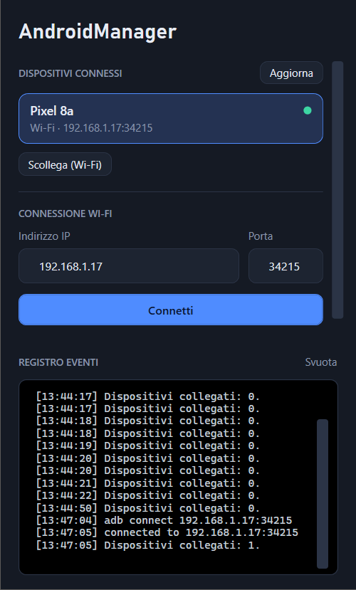
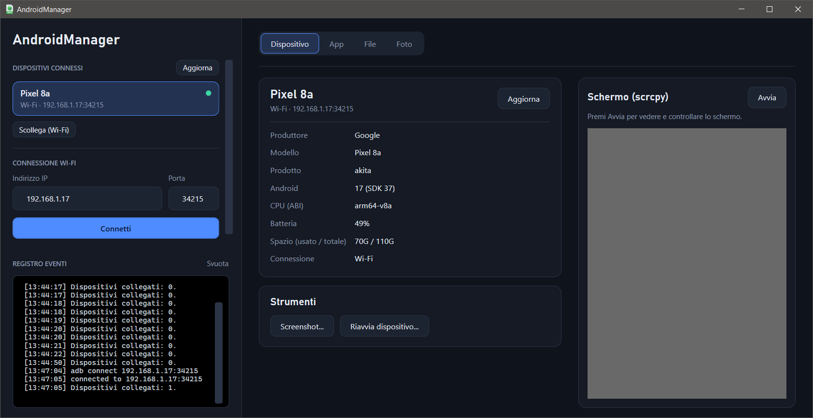
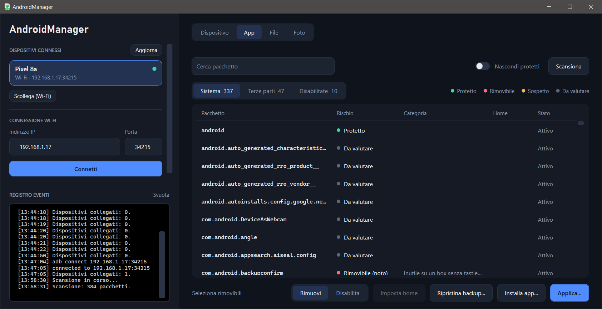
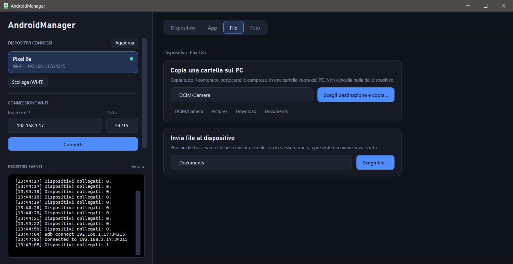
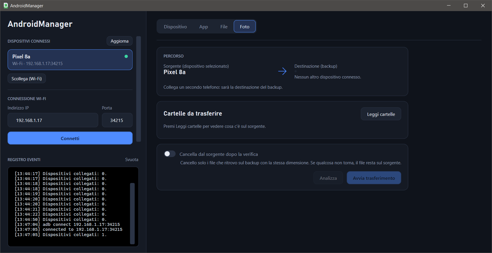

# AndroidManager

[🇮🇹 Italiano](README.it.md) · 🇬🇧 English

**A Windows desktop app to manage Android phones, TV boxes and tablets over USB or Wi-Fi: clean out bloatware, install APKs, move files, back up photos and mirror the screen, all from one window.**

Cheap Android TV boxes ship with dozens of preinstalled apps you never asked for, and moving files or photos between devices usually
means cables, cloud accounts or a pile of command-line `adb` calls. AndroidManager puts `adb` behind a simple window. It never
changes anything without asking, keeps a backup of what it removes and checks a photo copy before it deletes the original. It is written in C# with WPF on .NET 10.


## Key features

- **Several devices at once**: USB and Wi-Fi devices share one list on the left. Pick the one you want to work on.
- **Wi-Fi connection and pairing**: connect by IP and port, or pair with the Android 11+ code, with no cable.
- **Device facts**: maker, model, Android version, CPU, battery, storage and connection type.
- **Live screen with scrcpy**: see and control the screen from the PC. scrcpy is bundled in the exe, nothing to install.
- **Bloatware cleaner**: lists every package, ranks it by risk and removes or disables the ones you choose.
- **Backup and restore**: every removal is saved to a backup you can restore later, including apps that are only disabled.
- **Home launcher picker**: choose which installed app acts as the home screen.
- **APK installer**: pick APKs or drop them on the window. Each file is checked before it is sent.
- **File transfer**: send files to the device, or copy a whole folder to the PC.
- **Photo backup between two phones**: copies the folders you choose, checks the copy, then deletes from the source only what the backup holds.
- **Safe by design**: protected system packages are blocked, risky steps ask for confirmation, and closing the window stops the `adb` server it started.

## Before you start

You need a Windows PC and a device with **USB debugging** on (Settings → About → tap *Build number* seven times → Developer options → USB debugging).
For Wi-Fi on Android 11 or newer, use **Wireless debugging** in the same menu.

- **adb**: the app looks for `adb.exe` in an `adb` folder next to the exe, then in your `PATH`. It does not ship with `adb`, so install the
  [Android platform-tools](https://developer.android.com/tools/releases/platform-tools) and add them to `PATH`.
- **scrcpy**: already inside the exe. On first use it unpacks itself. If you prefer your own copy, use **Scegli scrcpy.exe...** (choose scrcpy.exe).
- **Runtime**: the ready-made exe in [`Extra/Build`](Extra/Build) needs the .NET 10 Desktop Runtime. If Windows asks for it, install it.

The app interface is in Italian.

## The main window

Devices, connection and log on the left. Four tabs on the right: **Dispositivo**, **App**, **File** and **Foto**.



### Find and connect devices

- **Scansiona** (scan) lists every device `adb` sees, USB and Wi-Fi. It runs by itself when the app starts.
- A green dot means the device is ready. An amber dot means it is offline or **unauthorized**: accept the debugging prompt on the phone and scan again.
- **Connetti** (connect): type the IP and the port (5555 by default). The last values are remembered.
- **Abbina** (pair), Android 11+: on the phone open *Wireless debugging → Pair device with pairing code*. Type the IP, the **Porta di abbinamento** (pairing port) and the **Codice** (code), press **Abbina**, then **Connetti** with the debugging port.
- **Scollega (Wi-Fi)** (disconnect) appears when a Wi-Fi device is selected.
- The **Registro eventi** (event log) at the bottom lists every step with the time. **Svuota** clears it. A progress bar above it shows the running operation.

While an operation runs the buttons and tabs are locked. Closing the window during one asks first.

## Dispositivo tab



- **Facts**: producer, model, product, Android version and SDK, ABI, battery, used and total space, USB or Wi-Fi. **Aggiorna** reads them again.
- **Screenshot...** saves a PNG of the device screen on the PC.
- **Riavvia dispositivo...** reboots the device after a confirmation.
- **Schermo (scrcpy)**: **Avvia** shows the live screen inside the window and lets you control it with mouse and keyboard.
  Selecting another device stops the mirror and starts the new one. Closing the window ends the scrcpy process.

## App tab

The package manager. Press **Scansiona** to read the packages of the selected device.



| Column | Meaning |
|---|---|
| **Pacchetto** | Package name |
| **Categoria** | Why it is listed (for example *Google / servizi*, *App preinstallate*, *Strumenti di fabbrica / test*, *Launcher originali*) |
| **Rischio** | Risk level, see below |
| **Stato** | Active or disabled |
| **Home** | The app can act as a home launcher |

**Filters**: **Sistema** (system), **Terze parti** (third party) and **Disabilitate** (disabled, system and third party), so you can re-enable them from here.

**Risk levels** (a hint, never an order: each device ships different packages):

| Level | Meaning |
|---|---|
| **Protetto** | Never touched: Android core, settings, installer, Kodi and the launcher tools. Needs an explicit opt-in |
| **Rimovibile** | Bloatware already removed with no problems on other devices |
| **Sospetto** | The name suggests streaming, a launcher or a factory tool |
| **Da valutare** | Unknown, decide by hand |

### Remove, disable, restore

1. Select the packages. **Seleziona rimovibili** picks every *Rimovibile* one. **Nascondi protetti** hides the protected ones.
2. **Rimuovi** (remove) runs `pm uninstall -k --user 0`: the app disappears for the user, the APK stays on `/system`.
   **Disabilita** (disable) hides the app without removing it.
3. The app asks for confirmation first, with the count. Protected packages are skipped unless you opt in, and the app refuses to remove
   every launcher, so the TV is never left without a home screen.
4. The app saves a **JSON backup** in `%AppData%\AndroidManager\backups` before it touches anything.
5. **Ripristina backup...** (restore) brings the packages of a backup back. A backup made on another device asks for confirmation. **Riabilita...** (re-enable) turns disabled apps on again.

### Home launcher

Select an app that has a value in the **Home** column and press **Imposta home** (set home). The device uses it as its launcher.
The column reads **Attiva** (active) for the current home and **Disponibile** (available) for the others.

### Install APKs

**Installa app...** opens a file picker, or drop one or more `.apk` files on the window. The app reads the manifest, validates each file
and asks you to confirm with a report of its findings. An invalid file is refused, and an older version than the installed one needs a second confirmation. Progress is logged every 25%.


## File tab



- **Invia file al dispositivo**: **Scegli file...** or drag files onto the window. A file with the same name already on the device is not overwritten.
- **Copia una cartella sul PC**: type the device folder in **PERCORSO** and press **Scegli destinazione e copia...**. It copies the whole content, subfolders included, into an empty folder on the PC. It deletes nothing from the device.

## Foto tab

Moves photos and videos from one phone to another through the PC, one file at a time, so the PC needs room for one file only.



1. Pick the **Sorgente** (source) and the **Destinazione (backup)** devices. They must be two different devices.
2. Tick the folders in **Cartelle da trasferire**: `DCIM/Camera`, `Pictures`, `Download`, `Documents`. **Leggi cartelle** reads what is there.
3. **Analizza** compares the folders with the backup and copies nothing. It shows what is new and what the backup already has.
4. **Avvia trasferimento** (start) copies the new files.
5. With **Cancella dal sorgente dopo la verifica**, the source file is deleted only when the same file, with the same size, is found on the backup.
   If anything does not match, the file stays on the source.
6. The progress shows three steps: copy and check, **Cancellazione dal sorgente** (delete from source), **Galleria del backup** (the backup phone's gallery is refreshed so the photos show up).

A file that changes during the copy, for example a video still recording, is never counted as backed up.

## Under the hood

**Two projects.** `AndroidManager.Core` holds everything that talks to Android and has no UI. `AndroidManager.App` is the WPF shell: the window and four views.
The Core uses `AdvancedSharpAdbClient` 3.7.17 for the `adb` protocol and calls the `adb` executable for pair and connect.

**One shared state.** `DeviceHub` keeps the device list, the selected device and the busy flag. Every tab listens to it, so selecting a device
or starting a job updates all of them, and no two jobs can run at once.

**Package safety.** `PackageClassifier` ranks a package with a regular expression for protected names, a list of known bloatware by category,
and a keyword match. `PackageRemover` re-checks protection when it runs, so a forged plan cannot bypass it, and it demotes any plan that would remove every home app.
`BackupStore` writes the JSON backup first, and the restore reads it back.

**Safe photo transfer.** `PhotoTransferPlanner` builds the plan, `PhotoTransferService` runs it in this order: pull to a temp folder, check the size,
push to the backup, list the backup again, compare sizes, delete from the source last, refresh the media index. The temp folder is removed at the end.

**Install check.** `ApkInspector` reads the binary `AndroidManifest.xml` (`AxmlReader`) and `ApkValidator` reports problems before anything is sent.

**Screen mirror.** `ScrcpyBundle` unpacks the embedded scrcpy 3.3.4 the first time, `ScrcpyLocator` finds it, and `ScrcpyHost` runs it and docks its window in the tab.

**Clean exit.** On close the app stops the `adb` server it started and drops its Wi-Fi sessions. If Windows is logging off it does this fast and never blocks.

**Tested.** The Core has an xUnit test project, `AndroidManager.Core.Tests`, with a fake `adb` and fake phones: adb parsing, endpoints and locator, package
parser, classifier, sorter and remover, backups and their migration, home manager, APK inspection, validation and install, remote paths and listing,
photo planning and transfer, scrcpy bundle and geometry, settings.

## Project layout

```
AndroidManager/
  AndroidManager.App/             WPF shell
    MainWindow.xaml(.cs)          devices, connection, log, tabs
    DeviceView, AppsView,         the four tabs
    FilesView, PhotosView
    ScrcpyHost.cs                 docks the scrcpy window
    Workspace.cs                  what the views share: adb, hub, log, settings
    Theme.xaml                    dark theme
    Resources/                    scrcpy zip, embedded in the exe
  AndroidManager.Core/
    Adb/                          adb service, endpoints, adb.exe locator
    Apk/                          manifest reader, inspector, validator, installer
    Devices/                      DeviceHub
    Files/                        remote paths, folder listing, device tools
    Mirror/                       scrcpy bundle, locator, launcher, screen geometry
    Packages/                     scanner, classifier, remover, sorter, backups, home manager
    Photos/                       transfer planner and service
    Settings/                     saved settings
  AndroidManager.Core.Tests/      xUnit tests
Extra/
  APK/                            sample APKs
  Build/                          compiled exe
  Immagini/                       logo, icon and screenshots
```

## Build and run

You need the .NET 10 SDK and Windows.

```bash
cd AndroidManager
dotnet test
dotnet run --project AndroidManager.App -c Release
```

Settings live in `%AppData%\AndroidManager\settings.json`, backups in `%AppData%\AndroidManager\backups`.
A ready-made exe is in [`Extra/Build`](Extra/Build).

## Status

A personal project, used on a few TV boxes and phones. A few things are worth knowing:

- **Removal is for the user only.** `pm uninstall --user 0` does not delete the APK from `/system`. A factory reset brings every app back.
- **Heuristics, not rules.** The risk levels come from tests on one Rockchip box with Android 10. Always read the package list before you remove something.
- **Backups are on this PC.** Restoring a backup on another PC needs the same JSON file.
- **Wi-Fi debugging** is as secure as your network. Use it on one you trust.
- **adb is not included.** Install it and add it to `PATH`, or put an `adb` folder next to the exe.
- **Windows only.**
